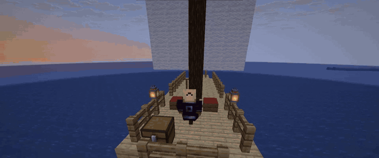
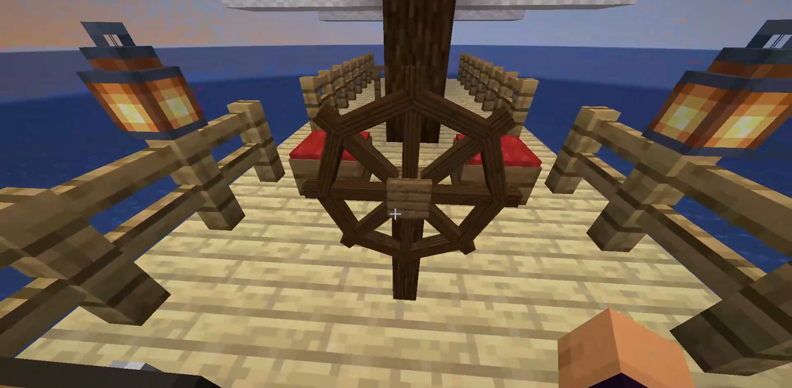

# Nautica

A Paper plugin for ships you build out of normal blocks, steer from a helm and
dock back as real blocks. No schematics, no resource pack, no client mods. You
build a hull in the water, put a helm on the deck and sail away

Paper 1.21.8, Java 21. It's a from-scratch rewrite inspired by
[SimpleShips](https://github.com/jemcdevitt/SimpleShips), not a fork, I only took
ideas from there.

> **Status: alpha (0.1.0).** Spawning, sailing and docking work and I've used them
> in game, but the anti-dupe edge cases (killing the server mid voyage, double
> chests, hoppers, pistons) haven't been properly tested yet. Try it on a test
> server before letting players near it

## Download

Grab the jar from [Releases](https://github.com/ImLele69/Nautica/releases), drop it in
`plugins/` and start the server once to get the config. No dependencies besides Paper

## How it plays

1. craft a helm (or `/ship give helm`) and place it on the deck, facing where you
   want the bow
2. right click the helm. the plugin flood fills the ship from there, takes it out
   of the world and you're sailing
3. W/S shifts gear, A/D steers, sprint straightens the course, jump rings the bell
   or raises/lowers the anchor, sneak docks
4. when you dock the ship goes back into the world as blocks, chests with their
   contents, signs, beds and all

Sneak + right click the helm on a docked ship opens the shipyard, where you spend
materials on modules: better sails, a steering wheel, oars, a steam engine
(burns coal from the furnaces on board), anchor, a navigation compass for
waypoints and the heart of the sea, which keeps storms off you.

Speed depends on what you built. Tonnage comes from block weights, sail area from
wool and banners above the deck, and wind direction matters, the HUD shows if
you're running, on a beam reach, close hauled and so on.

There are also seats for passengers, pads for animals (they leave with the ship)
and a perch the nearest parrot hops on.

## Commands

The command is `/ship`, `/nave` works too.

| Command | What it does |
|---|---|
| `/ship info` | stats of the ship you're piloting, or the closest docked one |
| `/ship crew add\|remove <player>` | crew members can pilot and sit in crew only seats |
| `/ship rename <name>` | up to 32 chars |
| `/ship transfer <player>` | give the ship away |
| `/ship waypoint <x> <z>` / `off` | autopilot, needs the compass module |
| `/ship give <helm\|seat\|pad\|perch> [player]` | admin |
| `/ship admin list` | every ship, its state and the ms/tick the plugin is using |
| `/ship admin recover <id> [force]` | place a ship from the virtual port where you stand |
| `/ship admin forcedock <id>` | dock a ship that's at sea |
| `/ship admin reload` | refused while ships are sailing |
| `/ship prefab list\|spawn <name> [heading] [force]\|save <name>` | prefab ships |

Builtin prefabs: `sloop` (48 blocks), `schooner` (330), `carrack` (758, with a
furnace and coal for the steam engine) and `stress` (1455, for load testing).
Look at the water and run `/ship prefab spawn schooner`.

## Permissions

| Permission | Default |
|---|---|
| `nautica.use` | everyone |
| `nautica.module.<sails\|helm\|oars\|steam\|anchor\|compass\|heart>` | everyone |
| `nautica.bypass.claim` | op |
| `nautica.bypass.size` | op |
| `nautica.admin` | op |
| `nautica.admin.prefab` | op |

## Config and languages

`config.yml` has size limits, speeds, which blocks are allowed on a ship and how
much they weigh, module costs and the "feel" toggles (wind, bobbing, roll,
particles, HUD). Every value has a comment.

Messages live in `plugins/Nautica/lang/`. English and Italian are bundled, pick
one with `language:` in config.yml. To add a language copy `en.yml`, translate it
and point `language` at it. Missing keys fall back to english.

Claims work with WorldGuard, GriefPrevention, Lands and anything else that
listens to block break/place, without depending on any of them (see below).

## Building

    ./gradlew test jar

The jar ends up in `build/libs/`. paper-api is compileOnly and there are no other
dependencies, so no shading. Tests run without a server: Bukkit's YAML,
`Material.matchMaterial`, JOML and Adventure work fine there, ItemStack
serialization doesn't, that's why the prefab tests skip chest contents.

For a quick test server: a flat world made of water works great

    level-type=minecraft:flat
    generator-settings={"layers":[{"block":"minecraft:bedrock","height":1},{"block":"minecraft:stone","height":20},{"block":"minecraft:sand","height":2},{"block":"minecraft:water","height":8}],"biome":"minecraft:ocean"}

## How it works

### Lifecycle

A ship is DOCKED, ASSEMBLING, SAILING or DOCKING, plus VIRTUAL_PORT when it
can't find anywhere to dock. Allowed transitions are in `ShipState.canMoveTo`,
recovery and admin commands bypass them with `forceState`.

The order of operations is what keeps ships from being duplicated
(`ShipController`):

1. `Assembler.capture` reads everything without touching the world: blocks,
   block entities, entities, fixtures
2. `SnapshotStore.writeDeparture` writes the blueprint and then the header in
   state ASSEMBLING, in a single task on the I/O thread
3. back on the main thread `Assembler.unchanged` reads it all again. if anything
   changed in the meantime (hopper, player, piston) the departure is cancelled
4. only now `WorldOps.remove` empties the block entities and removes the blocks
5. when docking, the DOCKING header is written to disk **synchronously** before a
   single block gets placed

### Recovery on startup

A record that isn't confirmed is first *looked for* in the world, at every
candidate pose: docking target, last position, departure point. It only gets
placed if it isn't anywhere. This is what turns a `kill -9` into a rollback
instead of a dupe, because the world on disk can be older than the record
(autosave).

`confirmed=false` means the record is ahead of the saved world. It flips to true
on the next `WorldSaveEvent` for that world, or on the next startup if the ship
is found where the record says.

### Files

- `plugins/Nautica/ships/<uuid>.yml` is the header (`ShipRecord`)
- `ships/<uuid>.blueprint.yml` is the blueprint
- `archive/` keeps old blueprints (`archive-keep`) and retired ships
- `prefabs/*.yml` use the same format as blueprints, so a prefab is just a
  snapshot and the other way around

All writes go through one thread (`Nautica-IO`) with a temp file, fsync and an
atomic rename. A sync write can't get overtaken by an async one started earlier.

### Coordinates

Headings are Minecraft yaw: 0 south, 90 west, 180 north, 270 east. All the math
is in `Rot`, covered by `RotTest`. +90 degrees of heading is a clockwise quarter
turn, (x, z) becomes (-z, x), same as `StructureRotation.CLOCKWISE_90`.

Blueprint offsets are relative to the pivot (the helm cell) in the frame the
ship had when captured. A docked pose always has a cardinal heading and sits on
the center of the pivot block, while sailing the pose is continuous.

### At sea

- **Rendering** (`ShipRenderer`): one invisible root ItemDisplay with every
  display as a passenger. Moving the ship is a single teleport with
  RETAIN_PASSENGERS. Turning has to rewrite the transformation of every display,
  so N packets, throttled by `rotation-update-ticks`
- **Collisions** (`CollisionModel`): only the hull shell is tested, at the real
  rotation, at the center of each block, and only when a cell enters a new block.
  If only keel cells hit, it's running aground, not a wall
- **Seats and animals**: pilot, passengers and animals sit on small invisible
  non-persistent armor stands teleported every tick. They aren't passengers of
  the root, it would stack them all on the pivot
- **Chunks** (`ChunkKeeper`): loaded async, tickets added once loaded. An
  unloaded chunk slows the ship down, it doesn't freeze the server

## Things that bit me

- **Waterline.** Water *under* the keel always has the hull above it, so it looks
  like "surface". Counting it made the bottom of the ship win, the waterline
  ended up under the hull and on departure every cell became air instead of
  water, leaving a ship shaped hole in the ocean. `Assembler.waterline` now only
  counts water at the sides going up the column, water below only counts for
  rafts
- **Blocks with a block entity renderer** (chests, beds, banners, heads, signs,
  pots) are invisible in a BlockDisplay. They become ItemDisplays, or for signs a
  slab with a TextDisplay. Their orientation can only be checked by looking at
  it, `render.item-yaw-offset` fixes it per kind
- **Removing a container can drop its contents.** `TileCodec.clear` always empties
  it first, the contents are already in the snapshot
- **Double chests split between ship and pier.** On capture both halves become
  SINGLE (`Capture.partners`), otherwise you get two orphan half chests
- **The helm item is a trapdoor.** On click the item use has to be denied
  (`setUseItemInHand(DENY)`) or it places a trapdoor too
- **Clicking Interactions.** Right click comes in as `PlayerInteractEntityEvent`,
  left click as Paper's `PrePlayerAttackEntityEvent`. `EntityDamageByEntityEvent`
  isn't needed
- **Sneaking off the helm.** You can't cancel `EntityDismountEvent`, the client
  desyncs. The pilot gets off, the next tick we try to dock and if that fails
  they're put back on (`remountPilot`). Everything the plugin does itself
  (eject, removing stands) goes through the `ShipController.internal` counter so
  the listener ignores those dismounts
- **Pilot quits, dies or teleports.** Take them out of the riders first
  (`pilotLeft`) and then dock, otherwise docking teleports them back on deck in
  the middle of their own teleport or quit
- **Entities load after blocks.** Recovery calls `chunk.getEntities()` (Paper
  waits for them) before looking for fixtures. Without it the helm looks missing
  and gets duplicated
- **Serializing entities.** `Bukkit.getUnsafe().serializeEntity` is deprecated, it
  uses `EntitySnapshot` (SNBT) instead. Item frames and similar get their facing
  set again after spawning, rotated
- **Claim checks are fake events** (`Protection.CheckBreakEvent` /
  `CheckPlaceEvent`, subclasses of the real ones). That's how it works with any
  claim plugin without depending on it, but logging plugins like CoreProtect see
  them. If you need to tell them apart, check the subclass
- **Paper plugins don't declare commands in yml.** `/ship` is registered through
  `LifecycleEvents.COMMANDS`
- **Builtin prefabs** are only written to `prefabs/` if the file is missing. If
  you change the generator delete the file to get it regenerated
- **Seat height.** The `-0.4` offset on a small armor stand comes from SimpleShips
  and I haven't measured it again

## Known limitations

These are choices for v1, not forgotten bugs:

- ships at sea pass through each other, collisions only look at blocks
- mobs on pads aren't in the snapshot. they're real entities and after a crash
  they stay where they were
- the steam engine only burns from the fuel slot of furnaces, smokers and blast
  furnaces on board
- the "which ship is this" index (`ShipRegistry.footprint`) is from the last
  docking, blocks added later by players go to whoever assembles first
- a picked up helm keeps the ship id. only the owner (or staff) reuses it, for
  anyone else it becomes a new ship
- no walkable deck while moving, no paintings, no Folia

## What's next

- proper testing of the dupe cases above, `kill -9` and double chests first
- tuning `item-yaw-offset` and `seat-y-offset` in game
- the shipyard on Paper's Dialog API once it's out of experimental, keeping the
  chest menu as a fallback
- a load test with 10 ships moving and 20 players

## License

MIT, see [LICENSE](LICENSE).
